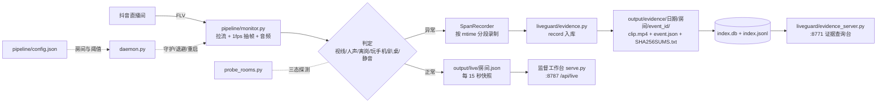

# 直播监督系统 · 架构说明

> 更新：2026-11-10 ｜ 适用：监督工作台 v1.0 + LiveVision 监看链路
> 本文只描述"现在真实在跑的东西"，不写规划中的功能。

## 1. 一句话定位

两层系统：**监督工作台**负责制度、评分、核对和看板；**LiveVision** 负责拉流、判定、异常录证和证据查询。视频**只用于异常留证**，不做实时画面传输。

## 2. 总体结构



## 3. 模块清单

| 模块 | 文件 | 职责 | 入口 |
|---|---|---|---|
| 守候进程 | `D:/LiveVision/daemon.py` | 每个房间一个 `monitor.py` 子进程；崩了重启；未开播 180 秒退避，开播窗口内 60 秒 | `main()` |
| 单房间监控 | `D:/LiveVision/pipeline/monitor.py` | 拉流、抽帧、判定、异常分段录制、写快照 | `main()` / `run()` |
| 取流 | `D:/LiveVision/pipeline/source.py` | 房间号/短链 → reflow 页 → 拉流地址；识别场次状态 | `DouyinSource.resolve()` |
| 视觉判定 | `D:/LiveVision/pipeline/detectors.py` | 人脸/人体/手机检测；`onscreen_state()` 三态 | 纯函数 |
| 录制 | `D:/LiveVision/pipeline/ringrec.py` | 环形缓冲、区间录制、分段合成、时长探测 | `RingRecorder` / `SpanRecorder` |
| 证据库 | `D:/LiveVision/liveguard/evidence.py` | 落盘、SQLite 索引、查询、哈希核验、重建 | `record/get/query/verify` |
| 查询台 | `D:/LiveVision/liveguard/evidence_server.py` | 页面 + `/api/*` + `/clip` Range 分块 | `Handler` / `main()` |
| 开播探测 | `D:/LiveVision/liveguard/probe_rooms.py` | 三态探测（在播/未播/未知）、重试、可选回写 room_id | `probe()` / `main()` |
| 判定纯函数 | `D:/LiveVision/liveguard/judge.py` | 说话片段有效性、视线判定、异常状态机 | 纯函数 + `AnomalyFSM` |
| 工作台服务 | `C:/Users/24526/WorkBuddy/监督/serve.py` | 静态页 + `/api/live` + `/api/report` | `main()` |
| 工作台页面 | `index/system/scoring/manual/check/tuangou/live.html` | 总览、制度、评分、手册、核对、团购、监看 | 浏览器 |

## 4. 数据流

1. **采集**：`monitor.py` 按 `config.json` 的房间拉流，1 fps 抽帧，音频走 VAD。
2. **判定**：视线（yaw/pitch/眼睛）、人声（VAD 占比）、离岗、玩手机、趴桌、静音，各自状态机。
3. **异常**：命中后 `SpanRecorder` 按切片 mtime 分段落盘，结束用 `concat_files()` 无损合成一个 mp4。
4. **入库**：`evidence.record()` 把片段移到证据目录，写 `event.json`、`SHA256SUMS.txt`，同时写 SQLite 和 JSONL 索引。
5. **快照**：正常/异常都会每 15 秒写 `output/live/<房间>.json`（分数、等级、出镜率、语音活跃率、事件数）。
6. **查询**：8771 读 SQLite/文件；8787 读 `output/periodic/latest.json`。

## 5. 数据模型

### 5.1 证据目录

```
output/evidence/
  index.db                       SQLite 索引
  index.jsonl                    追加日志（索引损坏可重建）
  YYYY-MM-DD/
    <房间>/
      YYYYmmdd_HHMMSS_<CODE>_<6位随机>/
        clip.mp4
        event.json
        SHA256SUMS.txt
```

- `CODE`：`GAZE`（未看镜头）、`QUIET`（说话音量过小/完全无人声）、`AWAY`（离岗）、`SILENCE`（长时间无讲解）、`PHONE`（玩手机）、`PRONE`（趴桌）。
- 目录名即 `event_id`，带时间和类型，肉眼可读。

### 5.2 event.json 关键字段

| 字段 | 含义 |
|---|---|
| `event_id` / `room` / `code` / `type` / `level` | 编号、房间、异常代码、中文类型、级别 |
| `start_ts` / `end_ts` / `duration_sec` | **触发时间**、结束时间、持续秒数 |
| `desc` / `evidence` | 判定说明，以及当时的 yaw/pitch/dBFS/阈值等**数据记录** |
| `clip.file` / `bytes` / `sha256` | 视频文件、大小、指纹 |
| `coverage` | 异常多长、实际录到多长、分几段、`complete` 是否录全 |
| `producer` / `created_at` | 谁写的、何时入库 |

### 5.3 快照 `output/live/<房间>.json`

`room / running / updated_at / video_sec / frames / metrics{cr,var,away_sec,...} / score / events / alerts / fusion / audio / screen`。

> 判断"是否正在采"只看**快照 mtime**：30 秒内更新才算在跑；文件里的 `running=true` 可能是上次留下的旧值。

## 6. 接口

### 8771 证据查询台（只读）

| 路由 | 说明 |
|---|---|
| `GET /` | 查询页（筛选 + 列表 + 一次点击直接播放） |
| `GET /api/rooms` | 配置里的全部房间 + 各自证据条数（0 条也显示） |
| `GET /api/events` | 按房间/类型/日期查 |
| `GET /api/event?id=` | 单条完整元数据 |
| `GET /api/verify` | 复算 SHA256，返回硬错误与覆盖不全提示 |
| `GET /api/stats` | 总数与占用 |
| `GET|HEAD /clip?id=` | 视频，支持 Range 206 / 416 / 256KB 分块 |

### 8787 工作台

| 路由 | 说明 |
|---|---|
| `GET /api/live` | 聚合 `latest.json`、心跳、简报列表、过期判断 |
| `GET /api/report?name=` | 指定简报原文（文件名白名单校验） |

## 7. 运行方式

```bash
# 工作台（8787）
python C:/Users/24526/WorkBuddy/监督/serve.py --no-browser

# 证据查询台（8771，默认只本机；--lan 手机同 WiFi 可访问）
D:/LiveVision/.venv/Scripts/python.exe D:/LiveVision/liveguard/evidence_server.py --no-browser
D:/LiveVision/.venv/Scripts/python.exe D:/LiveVision/liveguard/evidence_server.py --lan --no-browser

# 七房间守候
D:/LiveVision/.venv/Scripts/python.exe D:/LiveVision/daemon.py \
  --rooms 煲珠公 "夜猫(今天吃什么)" 夜猫团购 动漫AC君 瑞瑞吃喝记 "艾斯AI💫" 五行缺肉 \
  --device cuda --live-every 15 --peak-wait 60 --peak-window 30
```

> 必须用 `D:/LiveVision/.venv` 的解释器：系统 Python 缺 `cv2`，跑测试会 `ImportError`。

## 8. 关键设计决策

| 决策 | 原因 |
|---|---|
| 不做实时画面 | 用户明确要求；省带宽/显存；视频只留证 |
| 多房间复用 `monitor.py`，不每房间起 `guard.py` | 单 `guard` 实测约 721MB，四房间会把内存拖进换页 |
| 证据一条一目录 + SHA256 | 事后核查要能证明"没被改过" |
| 录制零 `os.remove` | 平台 safe-delete 抛 `SystemExit(1)`，会静默掐死后台录制线程 |
| 状态三态 `live/offline/unknown` | 旧逻辑把"链接失效/网络异常"一律叫"未播"，会误导 |
| 房间号按场次更新 | 抖音一场直播一个 `room_id`，旧号查不到新场次的流 |
| 查询台默认只绑回环，`--lan` 才开 | 证据是隐私数据，不能默认暴露到局域网 |
| 独占绑定（`SO_EXCLUSIVEADDRUSE`） | Windows 默认允许多实例绑同一端口，会抢请求 |

## 9. 已知边界

1. **抖音没有公开的"按主播名查开播"接口**：开放平台只对授权账号开放；网页搜索要登录+签名；第三方平台付费且有延迟。可靠路径只有"已知房间号/分享链接 → 拉流判断"。
2. **场次 ID 每场变、短链会失效**：开播后需要新的分享链接，`probe_rooms.py --update-config` 可回写新 `room_id`。
3. **限流/抖动**：连续探测多个房间时可能返回空壳页，表现为"未知"，重试一次通常恢复。
4. **单机架构**：SQLite + 本地文件；多人协作需要另接后端。
5. **手机访问依赖同一 WiFi**：Windows 防火墙、路由器 AP 隔离都会导致"电脑能开、手机打不开"。
6. **语音只判"有没有人说"**，不认人；换人/放录音要靠声纹或人工核。

## 10. 目录结构

```
监督/
├─ README.md                 总览与上手
├─ docs/
│  ├─ ARCHITECTURE.md        本文
│  └─ OPERATIONS.md          运行手册与排障
├─ index/system/scoring/manual/check/tuangou/live.html
├─ assets/                   样式与页面脚本
├─ data/search.json          全库检索索引
├─ build.py                  重建页面
└─ serve.py                  本地服务（8787）

D:/LiveVision/
├─ daemon.py                 多房间守候
├─ pipeline/                 取流、判定、录制
├─ liveguard/                证据库、查询台、探测、单测
├─ models/                   YOLO 权重
└─ output/                   live 快照、evidence 证据库、periodic 简报
```
